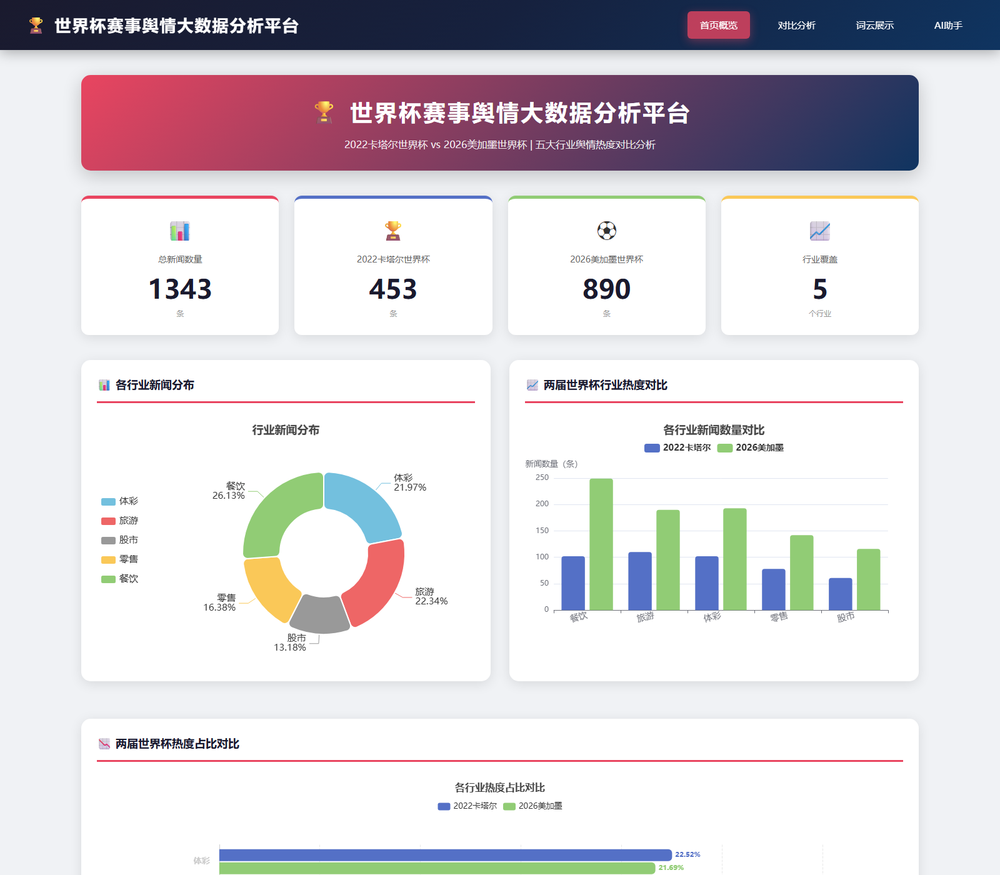
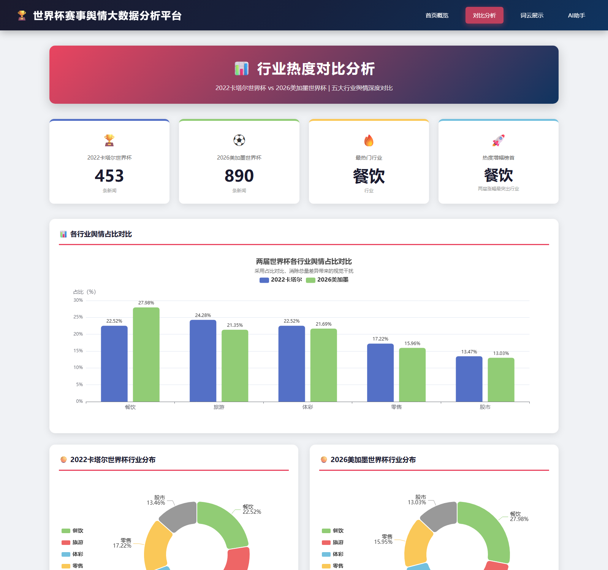
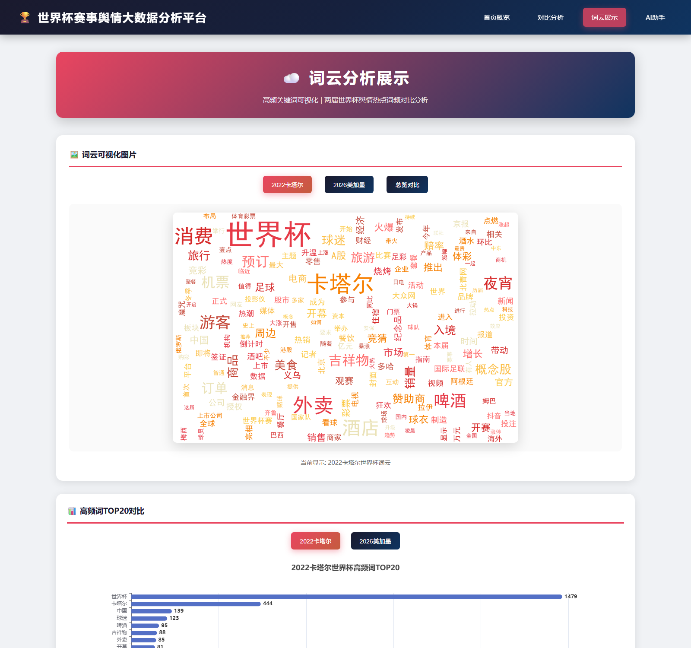

# 世界杯赛事舆情大数据分析平台

> 2022 卡塔尔 × 2026 美加墨 | 五大行业舆情热度对比分析

<p align="center">
  
</p>

## 项目简介

从新闻网站采集 **1343 条**与两届世界杯相关的报道，经清洗、中文分词与词频统计后，量化对比**餐饮、旅游、体彩、零售、股市**五个行业的舆情热度，并通过 Flask + ECharts 构建可视化分析平台。

要回答的问题是：世界杯带来的关注度，究竟落在哪些行业上？五年过去，这种分布有没有变化？

## 数据概览

| 指标 | 2022 卡塔尔 | 2026 美加墨 | 合计 |
|------|------------|------------|------|
| 新闻条数 | 453 | 890 | **1343** |
| 行业分类 | 5 个 | 5 个 | 5 个 |
| 数据来源 | 360 资讯、搜狗新闻、百度资讯、百家号、新浪网、央视网等 | — | — |

## 核心发现

| 行业 | 2022 占比 | 2026 占比 | 变化 |
|------|----------|----------|------|
| 餐饮 | 22.52% | **27.98%** | **+5.46 pp** |
| 旅游 | 24.28% | 21.35% | −2.93 pp |
| 体彩 | 22.52% | 21.69% | −0.83 pp |
| 零售 | 17.22% | 15.96% | −1.26 pp |
| 股市 | 13.47% | 13.03% | −0.44 pp |

**餐饮是唯一占比上升的行业，且升幅显著（+5.46 个百分点），其余四个行业占比均下降。**

一个可能的解释是讨论重心的迁移：2022 年卡塔尔世界杯是首次在北半球冬季举办，讨论更多集中在"看球"本身（旅游、观赛）；而 2026 年美加墨世界杯在夏季举办，与夜宵、啤酒、外卖等餐饮消费场景的绑定更紧密，反映在文本上就是「夜市」「外卖」「啤酒」「烧烤」等词的高频出现。

> 需要说明的局限：数据来源于公开新闻抓取，非社交媒体原始语料，且部分记录的时间字段缺失（标为"未知时间"）。上述结论是基于占比的观察性推断，不构成因果判断。

## 功能页面

<table>
<tr>
<td width="50%"></td>
<td width="50%"></td>
</tr>
<tr>
<td align="center">行业热度对比：占比横向对比 + 两届环形图</td>
<td align="center">词云展示：两届词云切换 + 高频词 TOP20</td>
</tr>
</table>

平台共四个页面：

- **首页概览** —— 数据总览卡片、行业分布环形图、两届热度对比柱状图
- **对比分析** —— 消除总量差异后的占比对比，便于横向比较两届结构变化
- **词云展示** —— 两届词云切换与高频词 TOP20 排行
- **AI 助手** —— 接入大模型接口，支持基于项目数据的问答

## 技术栈

| 环节 | 技术 |
|------|------|
| 数据采集 | requests + BeautifulSoup |
| 数据处理 | pandas |
| 中文分词 | jieba |
| 词频与词云 | wordcloud |
| Web 框架 | Flask |
| 数据可视化 | ECharts |
| 数据存储 | SQL Server（可选） |

## 快速开始

```bash
# 1. 安装依赖
pip install -r requirements.txt

# 2. 配置环境变量（AI 助手功能需要）
cp .env.example .env
# 编辑 .env，填入 SILICONFLOW_API_KEY

# 3. 启动 Web 应用
cd web
python app.py
```

浏览器访问 <http://127.0.0.1:5000> 即可查看分析结果。数据已随仓库提供，**无需先跑爬虫**。

如需更新数据：

```bash
python update_all.py    # 爬虫 → 数据转换 → 入库
```

## 项目结构

```
worldcup-sentiment-analysis/
├── spider/                     # 爬虫
│   └── world_cup_spider.py     # 新闻采集
├── analysis/                   # 数据分析
│   ├── data_converter.py       # 数据转换
│   ├── industry_analysis.py    # 行业热度统计
│   ├── word_freq_simple.py     # 词频统计
│   ├── wordcloud_generator.py  # 词云生成
│   └── import_to_sqlserver.py  # 数据入库
├── data/                       # 数据文件（已清洗，可直接使用）
├── web/                        # Flask 应用
│   ├── app.py                  # 主程序与数据接口
│   ├── chat_api.py             # AI 问答接口
│   ├── static/                 # ECharts、样式、词云图片
│   └── templates/              # 页面模板
├── sql/                        # 建表与去重脚本
├── docs/                       # 文档与截图
│   ├── screenshots/            # 界面截图
│   └── 世界杯赛事舆情大数据分析平台.pptx   # 项目汇报 PPT（17 页）
├── requirements.txt
└── update_all.py               # 一键更新
```

## 项目文档

| 文档 | 说明 |
|------|------|
| [汇报 PPT](docs/世界杯赛事舆情大数据分析平台.pptx) | 17 页，覆盖项目背景、系统架构、数据采集、功能模块、技术亮点与未来展望 |

> PPT 为 2026 年 7 月答辩时的版本，其中数据统计页记录的是当时的数据快照（1137 条）。后续补充采集后的完整数据为 1343 条，以 `data/merged_all.csv` 和上文「数据概览」为准。

## 数据说明

`data/` 目录下的核心文件：

| 文件 | 说明 |
|------|------|
| `merged_all.csv` | 清洗合并后的全量数据（1343 条），Web 应用的数据源 |
| `world_cup_news.csv` | 爬虫原始采集数据 |
| `industry_stats.csv` | 行业热度统计结果 |
| `industry_comparison.csv` | 两届对比数据 |
| `word_freq_*.csv` | 分词后的词频统计 |
| `web/static/images/wordcloud_*.png` | 生成的词云图片 |

CSV 采用 UTF-8 with BOM 编码，字段包含标题、链接、来源、发布时间、摘要、行业分类、年份、赛事名称。

## 常见问题

**Q：不装 SQL Server 能跑吗？**
能。Web 应用直接读取 CSV 文件，SQL Server 仅用于数据持久化的可选环节。

**Q：词频统计结果里有省略号怎么办？**
重新运行 `python analysis/word_freq_simple.py` 生成完整词频表。

---

课程：计算机本科课程期末大作业 | 开发时间：2026 年 7 月
